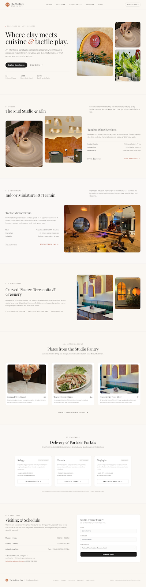

# The MudBrew Cafe — Studio, Arena & Dining

An intentional sanctuary combining artisanal wheel throwing, miniature indoor terrain crawling, and thoughtful culinary craft under warm acoustic arches.



---

## 🌟 Brand Intro & Application Architecture

The application is built with **React 18 + Vite 6 + Node.js/Express + SQLite (WAL Mode)**. It provides a complete experience featuring an editorial brand intro, full café marketing site, and a production-ready table reservation and studio experience booking system.

- **Animated Brand Intro (`CafeIntro.jsx`)**:
  - Full-viewport warm terracotta canvas (`#C06539`).
  - Subtle fade-in and scale-up of the botanical logo.
  - Soft opacity reveal of the `MUD BREW` wordmark and subtitle.
  - Understated minimal loading progress indicator.
  - Expanding circular/fade transition into the café homepage.
  - **`sessionStorage` Caching**: Plays smoothly once per browser tab session; subsequent navigations and refreshes instantly display the homepage.
  - **Accessibility**: Detects `prefers-reduced-motion` and provides an instant graceful fade.
  - **Fail-Safe**: Hard timeout guarantee prevents permanent loading states.
- **Complete Café Homepage (`HomePage.jsx`)**:
  - Full artisanal wheel pottery studio highlights.
  - 40 ft micro RC rock crawling arena.
  - Warm acoustic curved plaster dining sanctuary.
  - Studio pantry menu highlights.
  - Direct delivery partner portals (Swiggy, Zomato, Magicpin) & table inquiry form.
  - Prominent CTAs routing directly to table and experience bookings.
- **Customer Booking Experience (`/book` — `BookingPage.jsx`)**:
  - Dynamic category selector: **Dining Sanctuary Table** vs. **Studio & Brew Experience**.
  - Real-time availability calculation: query dates, opening hours, blocked dates, and remaining seat capacity per slot.
  - Configurable studio experiences catalogue loaded live from the backend.
  - Interactive calendar date picker with advance notice bounds.
  - Slot chips indicating real-time availability and remaining capacity.
  - Customer contact details, guest count selector, and special requests field.
- **Booking Confirmation (`/booking/:ref` — `BookingConfirmationPage.jsx`)**:
  - Distinct visual statuses: **"Request Received — Under Concierge Review" (Pending)** vs. **"Booking Confirmed"** vs. **"Declined"** / **"Cancelled"**.
  - Unique reference codes (e.g., `MB-TAB-2610-C27E`, `MB-EXP-2610-A19F`).
  - One-click reference copy button and calendar event download (`.ics` generation).
  - Transparent notification system indicator explicitly detailing unconfigured SMS/email gateways.
  - Direct contact follow-up channels for the concierge desk.
- **Protected Staff Admin Portal (`/admin` — `AdminDashboard.jsx`)**:
  - Secure JWT authentication with bcrypt password verification.
  - Metrics summary: Total Bookings, Pending Review, Confirmed, Cancelled, Completed, and Today's Visits.
  - Real-time search and multi-criteria filtering (status, type, date).
  - Quick actions to confirm, reject, cancel, or complete bookings.
  - Internal staff notes editor: write and persist private staff notes per booking to the database.
  - Experiences catalogue manager: add, edit, price, schedule, toggle visibility, and delete experiences.
  - Operating hours and table capacity rules manager.
  - Full-day closures and time-slot blackout scheduler.
  - Export filtered bookings directly to CSV.

---

## 📁 Project Directory Structure

```text
The MudBrew/
├── public/
│   └── logo.png                # Botanical logo asset (terracotta & ivory)
├── src/
│   ├── assets/
│   │   └── logo.png            # Local asset reference
│   ├── components/
│   │   ├── CafeIntro.jsx        # Reusable animated loading brand intro component
│   │   ├── CafeIntro.css        # Keyframes, circular unmasking & reduced motion styles
│   │   ├── HomePage.jsx         # Preserved homepage sections, layout & interactions
│   │   ├── BookingPage.jsx      # Customer-facing table & experience reservation flow
│   │   ├── BookingConfirmationPage.jsx # Confirmation & live status lookup
│   │   └── AdminDashboard.jsx   # Staff concierge portal (protected management)
│   ├── App.jsx                 # Client SPA route definitions
│   └── main.jsx                # React mounting entry point with BrowserRouter
├── server/
│   ├── db.js                   # Persistent SQLite initialization with WAL mode
│   ├── seed.js                 # Database seeder (admin user, default settings & experiences)
│   ├── index.js                # Express REST API & production SPA static server
│   ├── middleware/
│   │   ├── auth.js             # JWT authentication middleware for admin routes
│   │   └── rateLimiter.js      # Sliding-window rate limiting for bookings & login
│   ├── routes/
│   │   ├── public.js           # Public API: availability, settings, bookings creation & lookup
│   │   └── admin.js            # Protected admin API: bookings CRUD, experiences, rules, CSV
│   └── utils/
│       └── notifier.js         # Honest notification gateway dispatcher (email/WhatsApp)
├── test/
│   └── system-test.js          # 17 automated end-to-end integration tests
├── data/
│   └── mudbrew.db              # SQLite persistent database (git-ignored)
├── docs/
│   ├── DESIGN.md               # Terracotta & Kiln design system tokens & specifications
│   └── preview.png             # High-resolution design preview
├── index.html                  # HTML template with Google Fonts & Tailwind CDN configuration
├── vite.config.js              # Vite React plugin & development API proxy configuration
├── package.json                # Scripts & dependencies
├── .env.example                # Environment variable template with placeholders
└── .gitignore                  # Git ignore rules
```

---

## 🚀 Getting Started

### 1. Install Dependencies
```bash
npm install
```

### 2. Environment Variables
Copy the template file:
```bash
cp .env.example .env
```
Key configuration parameters:
- `PORT`: Server port (default: `5000`)
- `JWT_SECRET`: Secret key used to sign staff authentication tokens
- `ADMIN_DEFAULT_USER`: Initial admin username (default: `admin`)
- `ADMIN_DEFAULT_PASSWORD`: Initial admin password (default: `mudbrew2026!`)
- `SMTP_*`: Optional email credentials (leave blank if unconfigured)
- `WHATSAPP_*`: Optional WhatsApp Cloud API keys (leave blank if unconfigured)

### 3. Initialize & Seed Database
```bash
npm run seed
```
This initializes `data/mudbrew.db` with:
- Default staff manager account (`admin` / `mudbrew2026!`)
- Default operating hours (Mon–Fri 11:00–23:00, Sat–Sun 10:30–23:30)
- Curated experiences:
  1. *Artisanal Wheel Throwing & Glaze Session* ($45, 90 mins, max 6 seats)
  2. *Specialty Coffee Cupping & Pour-Over Masterclass* ($32, 60 mins, max 8 seats)
  3. *Miniature RC Rock Crawling Terrain Challenge* ($38, 75 mins, max 6 seats)

### 4. Run in Development Mode
In one terminal, start the API server:
```bash
npm run server
```
In a second terminal, start Vite frontend:
```bash
npm run dev
```
Open [http://localhost:5173](http://localhost:5173). Vite automatically proxies `/api` calls to `http://localhost:5000`.

### 5. Run Automated Tests
```bash
npm test
```
Executes all 17 automated end-to-end integration tests covering health, settings, availability calculation, booking creation, duplicate prevention, capacity enforcement, concurrency safety, admin authentication, status updates, staff notes, and CSV export.

---

## 🗄️ Database Schema & Concurrency Design

The system runs on native SQLite with Write-Ahead Logging (`WAL`) mode enabled, ensuring instant queries and ACID-compliant transactional writes.

### Tables
1. **`admin_users`**:
   - `id`, `username`, `password_hash`, `name`, `role`, `created_at`
2. **`experiences`**:
   - `id`, `name`, `tagline`, `description`, `price`, `duration_mins`, `max_participants`, `available_days`, `time_slots`, `is_active`, `created_at`, `updated_at`
3. **`settings`**:
   - `key`, `value`, `updated_at` (stores JSON opening hours, capacity per slot, advance notice window, auto-confirm toggles)
4. **`blocked_dates_slots`**:
   - `id`, `date`, `time_slot` (NULL for full-day closure), `reason`, `created_at`
5. **`bookings`**:
   - `id`, `reference`, `type`, `experience_id`, `customer_name`, `mobile`, `email`, `date`, `time_slot`, `guest_count`, `special_requests`, `status`, `staff_notes`, `ip_address`, `created_at`, `updated_at`

### Concurrency & Double-Booking Prevention
When a booking is submitted:
1. The server opens an immediate transaction (`BEGIN IMMEDIATE`), acquiring a write lock on SQLite.
2. It verifies that the selected date and time slot are not blacked out.
3. It recalculates the current active reservations (`status IN ('pending', 'confirmed')`) for that specific date and time slot.
4. If `current_reserved + requested_guests > capacity`, the transaction rolls back and immediately responds with `409 Conflict`.
5. Duplicate submissions with the same phone number, date, and slot within 5 minutes are rejected.
6. The booking is inserted with status `pending` (or `confirmed` if auto-confirm is toggled on in settings) and committed atomically.

---

## 🔐 Staff Admin Portal (`/admin`)

- **Default URL**: [http://localhost:5173/admin](http://localhost:5173/admin) (or port `5000` in production)
- **Default Username**: `admin`
- **Default Password**: `mudbrew2026!`
- **Staff Features**:
  - Live Booking Board with filter pills (Pending, Confirmed, Rejected, Cancelled, Completed).
  - Search by guest name, mobile, reference, or email.
  - One-click Confirm / Reject / Cancel / Complete actions.
  - Staff internal notes (private notes stored in database, not shown to customers).
  - CSV export for guest logs.
  - Live experience catalogue editor (add, edit, activate/deactivate, delete).
  - Capacity rule editor (table capacity per slot, max guests, notice hours, advance days).
  - Blackout date & time-slot manager.

---

## 📦 Production Deployment

### Option A: Unified Node.js Server (Recommended)
1. Build the frontend:
   ```bash
   npm run build
   ```
2. Start the unified production server:
   ```bash
   npm start
   ```
   Express will serve the built Vite static assets from `dist/` and handle client SPA routing fallback, while simultaneously serving the API on the same port (`PORT=5000` or hosting provider default).

### Option B: Two-Tier Deployment (Vercel / Netlify Frontend + Node.js Backend)
- Deploy the frontend to Vercel/Netlify with output directory `dist`.
- Set environment variable `VITE_API_URL` or configure rewrites in `vercel.json` pointing `/api/(.*)` to the Node.js backend.
- Deploy the `server/` directory and `data/` to a persistent Node.js host (e.g., Render, Railway, Fly.io, or VPS).

---

## 📋 Production Readiness & Integration Status

| Component | Status | Details |
|---|---|---|
| **Table Reservations** | ✅ Fully Functional | Real-time capacity check, validation, atomic locking, reference generation |
| **Experience Booking** | ✅ Fully Functional | Configurable catalogue, dynamic slots, participant limits, live pricing |
| **Availability Engine** | ✅ Fully Functional | Respects opening hours, advance notice rules, blocked dates & slots |
| **Concurrency Safety** | ✅ Fully Functional | ACID transaction with `BEGIN IMMEDIATE` prevents race conditions & double-booking |
| **Admin Portal** | ✅ Fully Functional | Protected JWT login, status management, staff notes, rule configuration, CSV export |
| **Automated Testing** | ✅ 17/17 Tests Passing | Comprehensive integration test suite in `test/system-test.js` |
| **Database Persistence** | ✅ Fully Functional | Persistent SQLite database in `data/mudbrew.db` with WAL mode |
| **Email Gateway (SMTP)** | ⚠️ Unconfigured | Framework ready in `notifier.js`; requires setting `SMTP_*` in production `.env` |
| **WhatsApp Business API** | ⚠️ Unconfigured | Framework ready in `notifier.js`; requires setting `WHATSAPP_*` in production `.env` |

### Pre-Launch Checklist for MudBrew Operations:
1. Change the default admin password from `mudbrew2026!` to a strong production secret in `.env`.
2. Generate a 64-character random string for `JWT_SECRET`.
3. (Optional) Provide SMTP credentials in `.env` if automated customer email confirmations are desired.
4. (Optional) Connect WhatsApp Business Cloud API in `.env` for instant WhatsApp alerts.
5. Backup `data/mudbrew.db` periodically or configure volume persistence on your hosting provider.
